# Armouring 5 Dashboard – Flow and Rules (Developer Guide)

Version 18-Nov-26 / Rev 3 · Laser Power & Infra, Kharagpur plant

Rev 2 added section 10: how the four plant cards are made.

Rev 3: names of men are shown only on the Labour Allocation Card. The production card shows only how many men are needed per shift.

This guide tells the developer what the Armouring 5 dashboard does, in what order things happen, and which rules it must follow. It goes with two things already sent: the handover file (16-Nov) and the Google Sheet "Armouring 5 – SFG Dashboard Data" (17-Nov).

---

## 1. What the dashboard is for

The dashboard is read in the Kharagpur morning meeting. It helps the team decide what Armouring machine 5 does today and what must be made ready for it. Armouring 5 is the slowest step in the plant, so every hour it waits is lost output.

It must answer four questions, in this order:

1. **Is there cable ready for the machine?** How many km are waiting in front of it, and how many days of work that is.
2. **Did the men produce?** How many men were put on the machine, and how many km they made.
3. **Are the bobbins ready?** How many bobbins are still to be wound for the running job and the next jobs.
4. **How much work is left?** Total km still to be armoured, and how many days that will take.

### Words used in this guide

| Word | Meaning |
|---|---|
| Armouring | Wrapping steel strip or steel wire around the cable to protect it |
| Inner sheath | The plastic layer put on the cable just before armouring |
| Outer sheath | The final plastic layer put on after armouring |
| Bobbin | The spool that holds armour strip or wire and is loaded on the armouring machine |
| Spooling | Winding strip or wire from big coils onto bobbins |
| Lot | One batch of bobbins to be wound for one cable job |
| Grid | The app where operators enter each drum they produce |
| ERP | The company system that holds orders, stock, and where each man was posted |
| SFG dashboard | The existing company web page that shows every order stage by stage, using ERP and Grid data |
| Shift day | The working day used for counting: 08:00 today to 08:00 tomorrow |
| Core km / cable km | Length of single cores (before they are twisted together) / length of finished cable |

---

## 2. Plant flow – where Armouring 5 sits

A cable order passes through these steps. The dashboard looks backward from Armouring 5 to see what is coming, and forward to see what is waiting after it.

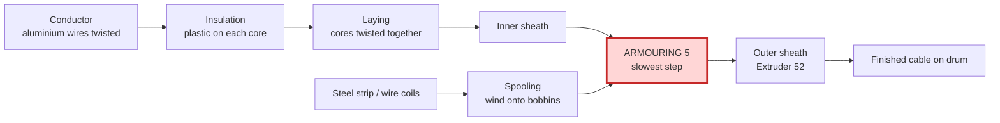

Two things feed the machine, and both must be ready at the same time:

- **Cable** with the inner sheath done.
- **Bobbins** filled with the right strip or wire for that cable.

If either one is missing, the machine stops. The dashboard exists to show this one day or more in advance.

---

## 3. Where the data comes from

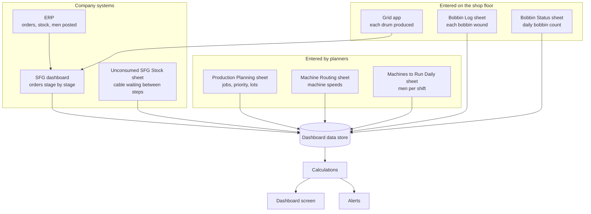

| Source | What the dashboard takes from it | How fresh it is |
|---|---|---|
| SFG dashboard – order lines | Every order, each step, quantity ordered, quantity done | Live |
| SFG dashboard – Grid entries | Each drum made on Armouring 5: time, order, cable, drum number, km, who entered | Live, as operators enter |
| SFG dashboard – men posted | Men posted on Armouring 5 (ERP cost code AR005), by date and shift | 1–2 days late |
| SFG dashboard – stock and dead stock | Stock of each item; old stock nobody is using | Live |
| Unconsumed SFG Stock sheet | Cable waiting between two steps (for example inner sheath done, armouring not done) | Updated automatically several times a day |
| Spooling Production Log – Production Planning | Jobs planned for the machine, priority, lots of bobbins | As the planner types |
| Spooling Production Log – Bobbin Log | Each bobbin wound: time, bobbin number, lot, turns | 4–5 times a day |
| Spooling Production Log – Bobbin Status | Daily count: loaded, filled, empty, damaged | Once a day |
| KGP Machine Routing | Speed of each machine in km per day | Changed rarely |
| KHG Machines to Run Daily | Men needed per shift (3 per shift for Armouring 5) | Set by the MD only |

The exact columns and sheet links are in the handover file. A sample of every SFG field is in the Google Sheet "Armouring 5 – SFG Dashboard Data".

---

## 4. Refresh flow – what happens on every update

Run this before the morning meeting (07:30) and then at fixed times in the day.

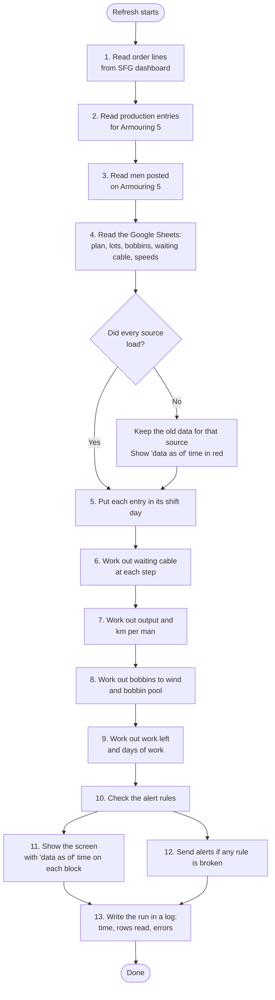

Rules for the refresh:

- **Never show a blank.** If one source fails, keep its last good data and show how old it is.
- **Never mix old and new silently.** Each block shows its own "data as of" time.
- **Stale warning.** If any source is more than 18 hours old, show it in red and send an alert.
- **Log every run.** Time, number of rows read from each source, and any error.
- **Do not connect to the ERP database directly.** Read ERP data only through the SFG dashboard's saved queries. This is the rule of the SFG dashboard's owner.

---

## 5. Screen flow – what the user sees, top to bottom

The order on the screen follows the order of the four questions. A user should be able to stop reading at any point and still have the most important facts.

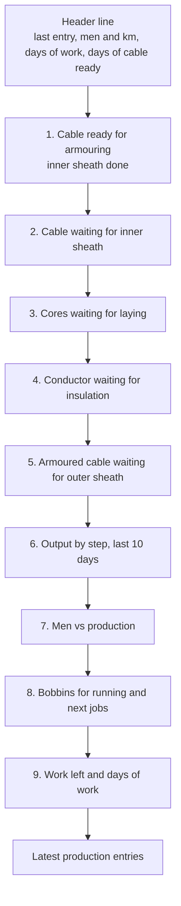

| # | Block | What it shows | How it is worked out |
|---|---|---|---|
| – | Header line | Date of the last entry on the machine; men and km on the latest day; days of work left; days of cable ready | Taken from blocks 1, 7 and 9 |
| 1 | Cable ready for armouring | km and orders with inner sheath done and armouring not done, biggest first | Inner sheath done minus armouring done, per order. Days of cover = km ÷ average km per working day |
| 2 | Waiting for inner sheath | km twisted together but not yet sheathed | Laying done minus inner sheath done |
| 3 | Waiting for laying | Cores insulated but not yet twisted together, shown as cable km | For each cable: the smallest of (core km done ÷ cores per cable), minus laying done |
| 4 | Waiting for insulation | Conductor made but not yet insulated | Conductor done minus insulation done. A conductor used by two items is counted once |
| 5 | Waiting for outer sheath | km armoured but not yet finished | Armouring done minus outer sheath done |
| 6 | Output by step | Bars per shift day for insulation, laying, inner sheath and Armouring 5, last 10 days. Slowest step in red | Sum of production entries per shift day |
| 7 | Men vs production | Men on day and night shift, km on day and night shift, km per man, average km per working day | Men from ERP posting; km from production entries. Average uses only days with production, last two weeks |
| 8 | Bobbins | Bobbins still to wind, extra wound, filled and lying unused; bar of the bobbin pool | See section 6 |
| 9 | Work left | All Kharagpur orders with armouring pending, km and days; part not yet in any plan; part not yet approved | Armouring ordered minus armouring done, per order. Days = km ÷ average km per day |
| – | Latest entries | Last 7 shift days of production entries | Straight list |

Later version (not needed for the first release): suggested job order, items common to several orders, full plant programme, and a machine-by-machine plan for the next 7 days.

---

## 6. Bobbin flow – from plan to machine

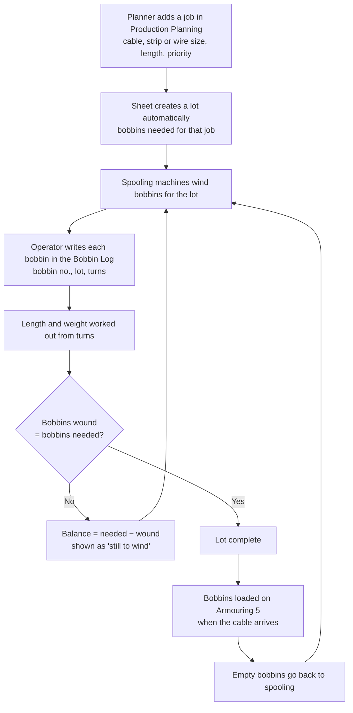

### Check for each job: will the bobbins be ready in time?

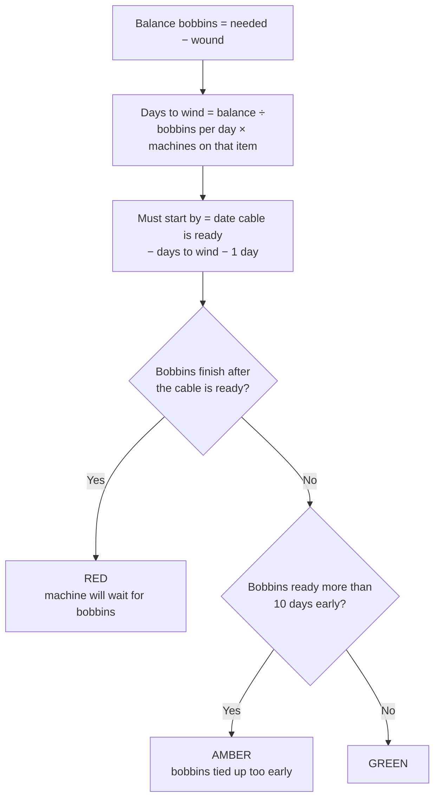

### Bobbin pool

- The plant owns a fixed number of bobbins (145 from 10-Nov-26). The owned number and its start date are kept in the Bobbin Status sheet.
- Every day the plant counts bobbins by state: loaded on machine, filled, empty, badly wound, in workshop, broken.
- **Not counted = owned − counted.** This must be zero. If not, show it clearly.

### Length from turns

The counter on the spooling machine slips, so length is worked out from the number of turns:

```
Length in metres = turns × 3.1416 × (196 + outer diameter of winding in mm) ÷ 2000
```

196 mm is the diameter of the empty bobbin's centre. Keep this and the other bobbin numbers in a settings table, not in code.

---

## 7. Rules the dashboard must follow

### 7.1 Data rules

| Rule | Detail |
|---|---|
| Shift day | An entry made before 08:00 belongs to the previous date's night shift. Night = before 08:00 or from 20:00. Day = 08:00 to 20:00 |
| Machine name | In production entries the machine is written exactly as `ARMOURING NO- 5`. In ERP men posting it is cost code `AR005` |
| Kharagpur orders | Production orders starting with `P7` are Kharagpur orders. Orders starting with `P1` belong to the other plant |
| Quantity done | Use the "done" figure shown by the SFG dashboard for each order and step. If the order quantity is above zero and nothing more is required for it, treat it as fully done |
| Which balance to trust | Take the SFG dashboard figure first. Then add production entries that are not yet in it. Never use a planning sheet's balance alone |
| Order number in entries | An entry may carry two order numbers, or a wrong one. Match by cable, drum number and metres as well |
| Stock to ignore | Stock with batch name `N.D.` is not the company's stock. Never count it |
| Units | Conductor and insulation are in core km. Laying, inner sheath, armouring and outer sheath are in cable km. Convert with the number of cores per cable |
| Men on the machine | ERP posting is 1–2 days late. For today's men, use the attendance punch data, not ERP |
| Average output | Average km per working day counts only days that had production |
| Duplicate entries | The same drum number entered twice on one machine must be flagged, not added twice |

### 7.2 Planning rules

| Rule | Detail |
|---|---|
| Slowest step sets the pace | Armouring and laying are the slowest steps. Earlier steps may run at most 30% faster than the slowest step. More than that only piles up stock |
| Feed comes first | A job cannot be planned on the machine unless inner sheath is done, or planned for the day before |
| Only approved work | Plan only the lots the MD has ticked as approved. Only the MD creates or approves lots |
| One armour type per lot | Strip 4×0.8 mm and strip 4×0.6 mm are never in the same lot. Wire lots are grouped by wire size |
| Machine speed | Use the machine's own past output: about 10 km a day on small cables and about 7 km a day on big cables. Keep one speed table by cable size |
| Do not start and stop | Armouring, laying and sheathing machines are not planned for half days or on-off days |
| Use old stock first | If matching old stock exists, use it before making new |
| Outer sheath drums | Finished-cable drums must be ready 4 days before outer sheath |

### 7.3 Bobbin rules (flag each of these)

- Bobbins wound without a lot are more than 30% of a day's winding.
- Turns on a bobbin are below 90% of the target, or the item or bobbin number is blank.
- A filled bobbin is more than 7 days old, or has no approved lot.
- Strip on the machine does not match the job (for example 0.6 mm loaded for a 0.8 mm job).
- Strip weight used differs by more than 5% from (km armoured × kg per km).
- A bobbin has been in the workshop for more than 7 days.
- More than 3 badly wound bobbins in one day.
- Bobbins counted is not equal to bobbins owned.
- A finished job still has an open lot. Open lots that are really finished make "bobbins still to wind" wrong.

### 7.4 Display rules

- Colourful screen with a different colour for each block. The users remember blocks by colour.
- The slowest machine is shown in red. A machine with no work is shown in a different colour.
- No Gantt charts. Use tiles and a day-by-day board.
- Show the customer's name, not only the order number.
- When a machine has no work, write that its men "can be utilized for some other purposes". Do not write "free" or "idle".
- Biggest items first in every table.
- Every block shows its "data as of" time.
- Must work on a desktop and on a phone.

### 7.5 Settings, not code

Keep every number that may change in one settings table: machine speeds, the 30% limit, the 10-day and 7-day limits, bobbin sizes, men per shift, alert limits, and refresh times.

---

## 8. Alerts

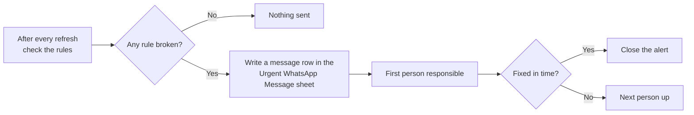

| Alert | When it fires |
|---|---|
| Cable running short | Days of cable ready for the machine fall below the set limit |
| Bobbins short | Any job is RED in the bobbin check |
| Men but no output | Men are posted on the machine but no production entry in a 6-hour window |
| Figures do not match | Armouring km in ERP and in production entries differ by more than 0.5 km |
| Bobbin count wrong | Bobbins counted is not equal to bobbins owned |
| Data too old | Any source is more than 18 hours old |

Who gets each alert first, and who is next, will be given by the MD.

---

## 9. Build and go-live flow

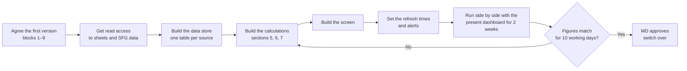

Side-by-side check, every morning for 2 weeks: last production entry, km and men for the latest day, cable ready in km, bobbins still to wind, work left in km and days. Accept when all match within 0.5 km and 1 bobbin for 10 working days, and every refresh ran on time.

Build it so that the machine is a choice on the screen. The same dashboard will then serve Armouring 1, 4 and 6.

---

## 10. Card logic – how the cards are made

Four cards are made from the same data as the dashboard. They tell the plant what to make, who makes it, and which drums to keep ready.

| Card | What it tells | Made from |
|---|---|---|
| Machine Production Cards | For each machine, day by day: which order, how much, what material, where its feed comes from, and how many men are needed per shift (no names) | Approved lots + what is already made + machine rules |
| Labour Allocation Card | Which men are on which machine, day and night | Production card + roster + skill sheet |
| Finished Goods Drum Requirement Card | How many drums of which size are needed by which date; how many are in stock; how many are short | Outer sheath dates in the plan + drum stock sheet |
| Drum Assembly Cards | One block per date: which drums to assemble that day | Drum requirement card |

### 10.1 Where card-making sits in the flow

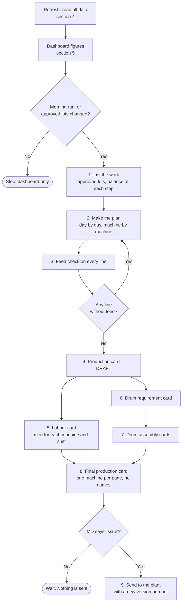

The dashboard figures run on every refresh. Card-making runs once in the morning, and again only when the approved lots change.

### 10.2 Step 1 – list the work

1. Take only the lots the MD has ticked as approved, in the order he has set.
2. For each order in those lots, find the balance at each step: conductor, insulation, laying, inner sheath, armouring, outer sheath.
3. Balance = ordered − done. Take "done" from the SFG dashboard first, then add production entries not yet counted there.
4. Where the two sources differ, plan on the lower figure and list the difference on the card. Never pick one silently.
5. For a cable with 3 full cores and 1 half core, keep the full core and the half core as separate lines. One km of cable needs 3 km of full core and 1 km of half core.

### 10.3 Step 2 – make the plan

The plan is built one day at a time, starting from today, for 15 days.

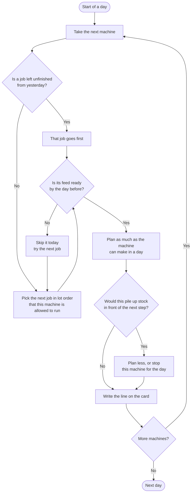

Rules used while planning:

| Rule | Detail |
|---|---|
| Feed must be ready the day before | A job is planned only if the earlier step has made its feed, or is planned to make it, by the previous day |
| Unfinished job first | A job left unfinished runs first on the same machine. Later jobs move back |
| Lot order | Finish earlier lots before later ones. A later lot may start only when the earlier lot does not need that machine |
| Do not pile up | Earlier steps may run at most 30% ahead of the slowest step. Count stock already lying first |
| Fewer changes | Keep the same size or the same plastic running on a machine as long as possible. Each change costs 4 to 8 hours |
| No half days | Armouring, laying and sheathing machines run full days or not at all. Conductor machines may stop for a shift |
| Storage limit | Only about 24 drums are available to hold insulated cores. Do not plan more insulation than these can hold |
| Drums for bare conductor | Conductor that is wound straight onto finished drums is planned only if those drums are in stock or due the day before. If not, show the machine as "waiting for drums" with the shortage |

Machine speeds used for a day's plan (keep in the settings table):

| Machine | Daily output used |
|---|---|
| Armouring 5 | 7 km on big cables, 10 km on small cables |
| Laying 5 | 5 km of big cable plus 7 km of small cable |
| Extruder 52 (inner and outer sheath) | About 9–12 km inner or 8–13 km outer. Both share the same day |
| Extruder 22 (insulation) | About 40 core km |
| Sioplas line 4 | About 9 core km of high-voltage core, or about 23 km of covered conductor |

Which machine may run which job (keep as a table, not in code):

| Job | Machine |
|---|---|
| All laying | Laying 5 |
| All inner and outer sheath | Extruder 52. Extruder 51 is kept at rest unless the plant asks for it |
| Insulation of 16 sq mm | Extruder 35 only |
| Conductor 150 to 300 sq mm | Multistrand 14 |
| Conductor above 300 sq mm, and all conductor of 300 sq mm and above for Sioplas line 4 | Multistrand 11 |
| Conductor with 19 wires (for example 70 and 95 sq mm) | Skip (12+7)-1. Never Skip 10 |
| Small 7-wire conductor (25, 35, 70 sq mm half core) | Skip 10 |
| Covered conductor 100 sq mm | Multistrand 18 |
| Size not in this table | Mark "to confirm" and ask the plant. Do not guess |

### 10.4 Step 3 – feed check

Run this on every line of the plan, order by order. Never check on a total of several orders.

```
Feed available = made at the earlier step and not yet used
               + planned at the earlier step up to the day before

The total planned so far at this step must not be more than the feed available.
```

If a line fails, do one of three things and say which on the card:

1. Add the earlier step's job on a named machine and date.
2. Move the job to the day its feed exists.
3. Remove it and list it as "cannot be planned – feed missing".

Print the result at the top of the card: lines checked, lines with feed ready, lines with no feed.

### 10.5 Step 4 – the production card

Machines appear in this order: wire drawing, skip machines, multistrand, laying, armouring, then extruders and Sioplas.

Each job line shows:

- Date
- Order number and its customer order reference
- Customer name and cable
- Core (full, half, or size)
- Lot
- Quantity planned
- Material that will be used (quantity × the material list for that item)
- Where the feed comes from (in stock with quantity, or machine and date)

Colour of each machine's card:

| Colour | Meaning |
|---|---|
| Red | The slowest machine – everything waits on it |
| Violet | No work in the plan |
| Blue | Low work – runs 3 days or less in 15 |
| White | Normal |

On the Extruder 52 card, small-cable jobs that Extruder 51 could take are marked in orange, with a tick box asking the plant whether to shift them.

### 10.6 Step 5 – the labour card

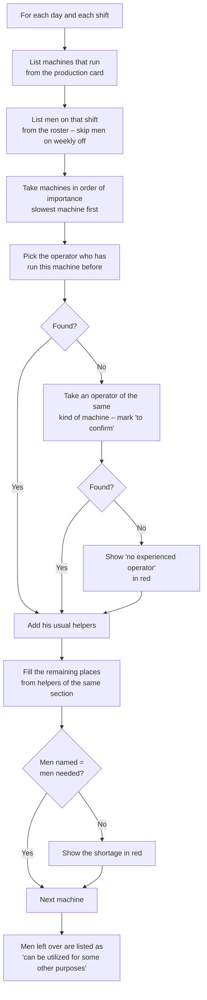

Rules:

- Men needed per shift on each machine is set by the MD only. Do not change it.
- Shifts and weekly offs come from the roster. The card changes only which machine a man is on.
- A man never goes from night shift to day shift the next day.
- Every machine, every shift, must have one operator who has run that machine.
- Men whose factory entry is blocked are never used.

### 10.7 Steps 6 and 7 – the drum cards

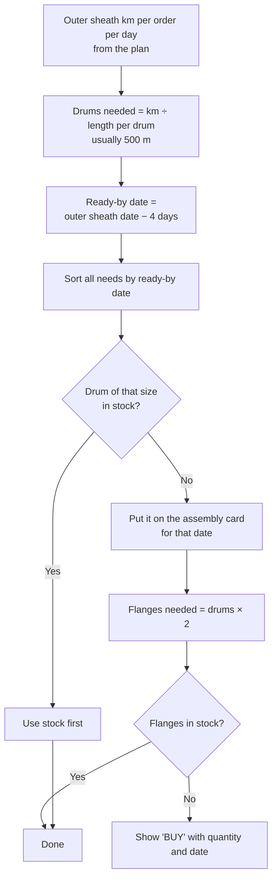

Rules:

- Drum size for each order comes from the drum stock sheet. If an order has no size there, show "size to confirm". Do not guess.
- Conductor wound straight onto finished drums needs its drum the day before the machine runs, not 4 days before.
- A ready-by date already in the past is shown as "LATE – needed now".

### 10.8 Steps 8 and 9 – final card and issue

1. The final production card has one machine starting on each new page, with the operator and helpers named for day and night.
2. Every card carries a version label: date and revision number. The first card of a day is Rev 1. Every later card that day gets the next number, even a draft. Two different cards never carry the same number.
3. The card states which earlier card it replaces and what changed.
4. Nothing is sent until the MD says "issue". Only the final card is sent.
5. Before the next day's card, read the plant's report on today's card (what ran against what was planned, and why) and apply it.

---

## 11. Open points to settle before building

1. **Production entries for Kharagpur have stopped in Grid.** The last Kharagpur entry in Grid is 16-Nov-26. It is being said that entries now go straight into ERP. Confirm the new source of production entries before building blocks 6, 7 and the header. Everything in this guide that says "production entries" must read from that confirmed source.
2. **Access to SFG data.** Agree with the SFG dashboard's owner how the new dashboard will read its data without a person's browser being open.
3. **Men posted for today.** ERP posting is late. Decide whether to read the attendance punch data for the current day.
4. **One speed table.** Two speeds are in use today (7.8 km a day in the routing sheet; 7 and 10 km a day in planning). Fix one table by cable size.
5. **Open lots.** Some finished jobs still show open lots. The plant must close them, or "bobbins still to wind" will be wrong from day one.
6. **Bobbin Log to Spooling Data.** Confirm the automatic fill from the Bobbin Log is working.
7. **Alert owners.** The MD to name the first and next person for each alert.
8. **Card-making in the first version or later.** Decide whether section 10 is built with the first version or after the dashboard is accepted. The plan in section 10 covers all Kharagpur machines, not only Armouring 5.
9. **Speeds and machine table for the cards.** The plant must confirm the daily speeds and the job-to-machine table in section 10.3. Some sizes are still "to confirm" (for example 10, 16, 50 and 95 sq mm conductor).
10. **Stock tabs in the data sheet.** The hourly update of the Google Sheet refreshes the production, pending and men tabs. The stock tabs are as of 17-Nov-26.
